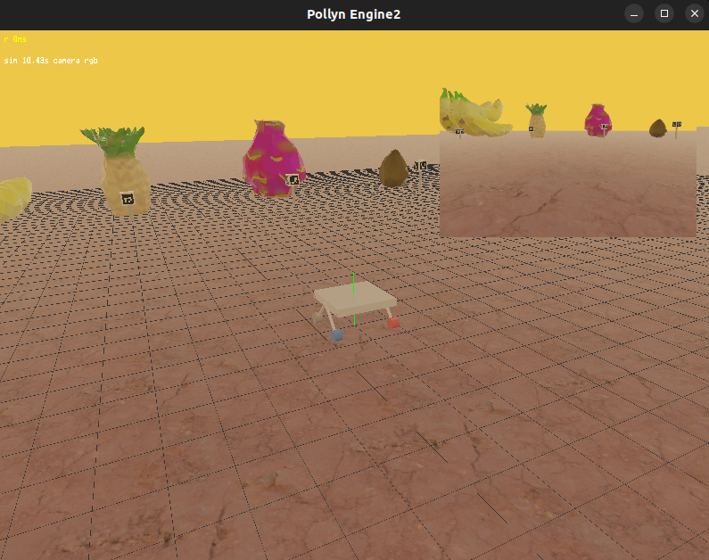

# Trellis2 Simulator

[](https://github.com/ravengraves/trellis2/actions/workflows/build.yml)

This is a Pika/GLESv2 rover simulator for ros3! The main simulator is
`cmd/urc_simulator/main.pka`; reusable rendering, mesh, texture, and postprocess code
lives under `internal/pollyn_engine/`; integration and rendering tests are under `test/`.



## Quick Start

Install the [dependencies](#install-dependencies), then run these commands from
the repository root:

```sh
ninja urc_simulator
```

Start `rosecore` in a separate terminal for ROS3 communication, then launch the
simulator with the bundled rover model:

```sh
./build/urc_simulator
```

Use `./build/urc_simulator --terminal` for terminal rendering. Drag with the
left mouse button to orbit, use the arrow keys to pan, and scroll to zoom.
Press `D` to switch the camera preview between RGB and depth.

Run `ninja check` to build and run the automated checks. See
[Executables](#executables) for the model viewer, visualization tools, and joystick.

## Repository Layout

All paths below are relative to the Trellis2 repository root.

```text
trellis2/
├── build.ninja                  # Application builds and shared build settings
├── cmd/
│   ├── urc_simulator/           # Rover simulator and general MuJoCo viewer
│   ├── image_view/              # Image-topic viewer
│   └── vjoy/                    # Virtual joystick
├── internal/
│   ├── pollyn_engine/           # Rendering engine, shaders, and graphics shim
│   ├── shim/                    # MuJoCo C bridges
│   └── bindings/ros3/           # Pika bindings for ROS3 and Mirage
├── vendor/mujoco/               # Customized MuJoCo source and dependencies
├── models/                      # MuJoCo models, meshes, and textures
├── assets/                      # README screenshots
├── test/
│   ├── build.ninja              # Test builds and check commands
│   ├── test_*.pka               # Tests and interactive demos
│   └── assets/                  # Local test fixtures
├── doc/                         # Implementation notes and checklists
├── .github/workflows/build.yml  # CI builds and checks
├── AGENTS.md                    # Contributor and agent guidelines
├── README.md
└── build/                       # Generated executables and intermediate files
```

The main simulator entry point is `cmd/urc_simulator/main.pka`; the general
model viewer starts in `cmd/urc_simulator/viewer_main.pka`. Reusable code is
under `internal/`, and all bundled models and test assets are local to this
repository. The build uses installed Pika/Rose dependencies and the MuJoCo
source in `vendor/mujoco/`.

## Install dependencies

The current build targets Linux. On Ubuntu 24.04 / a recent Debian-based
distribution, install the development tools and graphics/test dependencies:

```sh
sudo apt update
sudo apt install build-essential clang llvm lld git curl python3 ninja-build \
  pkg-config libglfw3-dev libgles2-mesa-dev libegl1-mesa-dev \
  xvfb xauth coreutils python3-pip scdoc
```

Python must be 3.9 or newer. Bash and GNU Make are also required. Other Linux
distributions need equivalent packages. Headless graphics tests need Xvfb,
xauth, and a working software GLES/EGL driver; ROS3 tests need access to POSIX
shared memory. Installing headers alone is not enough to run graphics tests.

### Pika compiler and runtime sources

```sh
curl -fsSL https://raw.githubusercontent.com/ravengraves/pika/master/install.sh \
  -o /tmp/pika-install.sh
sh /tmp/pika-install.sh
command -v pika2c
```


### Rose libraries

```sh
curl -fsSL https://raw.githubusercontent.com/ravengraves/ros3/master/install.sh \
  -o /tmp/ros3-install.sh
sh /tmp/ros3-install.sh
```


### Customized MuJoCo

The customized MuJoCo source, its dependencies, licenses, and original
[README](vendor/mujoco/README.md) are included in `vendor/mujoco`. Build it with:

```sh
ninja mujoco
```

## Build and Test

Run Ninja and applications from the Trellis2 root. All model, texture, and
fixture paths are relative to that directory. Linux, Python 3.9+, Ninja,
installed Pika/Rose, and GLFW/GLES/EGL development libraries are required.
Ninja builds the required shaders, MuJoCo libraries, and bridges before their
application or test targets.

```sh
ninja                     # Main executable: build/urc_simulator
ninja all                 # All applications
ninja image_view          # One application
ninja check               # Build tests and run automated checks
./build/test_robot_motion # Run it
```

Dependencies and tools can be selected through environment variables:

```sh
PIKACC=/path/to/pikacc CC=gcc ROSE_PREFIX=/opt/rose ninja all
MUJOCO_DIR=vendor/mujoco ninja urc_simulator
```

`ROSE_PREFIX` defaults to `/usr/local`; `MUJOCO_DIR` defaults to `vendor/mujoco`,
and `MUJOCO_LIB_DIR` defaults to that directory's `build/lib`. `ROSE_CFLAGS`,
`ROSE_LIBS`, `GL_LIBS`, `CFLAGS`, `PIKAFLAGS`, `PYTHON`, and `NINJA` can also be
supplied explicitly. The default Rose link flags include the selected prefix's
library directory as a runtime search path.

Start installed `rosecore` in a separate terminal before an interactive ROS3
session, using the same `ROSE_BASE` for communicating processes.
`ninja check` depends on `tests`, so all test binaries are built before execution. Graphics checks require Xvfb/xauth and a functioning software GL driver; ROS3
checks require shared-memory access. Interactive demos are compiled by `ninja tests` but excluded from `ninja check`.

### Executables

Build an executable with `ninja <target>` and launch `./build/<target>` from
the repository root.

| Target / executable | Function |
| --- | --- |
| `urc_simulator` | Main rover simulator with MuJoCo physics, robot controls, rendering, and ROS3 sensor/motion topics. Default build target. |
| `trellis2` | General MuJoCo model viewer; for example, `./build/trellis2 models/ball.xml`. |
| `image_view` | ROS3 image-topic viewer with optional bounding-box overlays. |
| `vjoy` | Virtual joystick that publishes linear and angular velocity commands, typically on `/cmd_vel`. |


## Run the Simulator and Joystick

Run the rover simulator with:

```sh
./build/urc_simulator --render-fps 30 --physics-hz 1000
```

Rendering is capped by simulation time, defaulting to 30 FPS. Physics uses Rose
wall-clock pacing and the MuJoCo timestep; `--physics-hz` sets that timestep so
the simulator can step at 1000 Hz while rendering less frequently.
Use `--radiation` to add sparse bright channel hits to the mounted camera RGB
feed and the main 3D view, and `--dust` to fade the mounted camera image and
main 3D view toward dust by 20m. The sensor effects affect both the preview
texture and the `/simulator/rgb` published image. You can also use `--terminal`
to do rendering to the terminal (through Pollyn Engine).


## ROS3 Motion Topics

Reusable Pika bindings live in [internal/bindings/ros3](internal/bindings/ros3/README.md).
They use native Pika adapters and `@symbol` declarations, passing null allocation
hooks and callbacks internally.

`urc_simulator` publishes motion data independently of rendering:

```text
/simulator/imu  F64[7]  [time, wx, wy, wz, ax, ay, az] at physics Hz
/simulator/vio  F64[7]  [time, x, y, z, vx, vy, vz] at 30 Hz
```

IMU angular rate and acceleration are body-frame values from MuJoCo sensors when
`imu_gyro` and `imu_accel` exist, with a frame-body fallback for older rover
XML. VIO position and velocity are in the MuJoCo world frame.

## Static Environment Assets

Static environment assets are loaded from a directory and attached to an
existing MuJoCo geom by name. The MuJoCo geom remains the collision/physics
object, while the Pollyn Engine asset supplies the visible textured render
mesh.

The bundled fixture in `test/assets/static_env` demonstrates this layout:

```text
test/assets/static_env/render.obj
test/assets/static_env/albedo.png
test/assets/static_env/normal.png
test/assets/static_env/orm.png
```

`render.obj` and `albedo.png` are required. `normal.png` and `orm.png` are
optional; missing optional textures leave the corresponding material slot
disabled. The OBJ should be authored in the same local frame and units as the
MuJoCo geom it is bound to.

Use `env_static_asset_load(asset_dir, geom_name)` to load the asset, then add it
to a render pass with `env_static_asset_add_to_pass(...)`. The loader resolves
`geom_name` through MuJoCo and updates the render transform from the geom pose,
so the same asset path works for both the main view and sensor camera passes.

To use the MuJoCo geom only as a collision proxy, set its alpha to zero:

```xml
<geom name="static_collision"
      type="box"
      pos="1.8 1.8 0.18"
      size="0.5 0.4 0.2"
      rgba="1 1 1 0"/>
```

`scene_init(...)` skips MuJoCo geoms whose resolved alpha is zero, so the proxy
does not draw as a primitive, but MuJoCo still uses it for collision. The
textured render asset attached to `static_collision` is drawn instead in the
static-environment test.

The simulator loads the bundled visual markers under `models/`. The reusable
static-asset loader is exercised by `test/assets/static_env`.

## Asset Export Requirements

Export static props from Blender as Wavefront OBJ with UVs and normals. The
loader intentionally supports only `v`, `vt`, `vn`, and `f` records and
triangulates polygon faces as a fan. Keep meshes modest: the engine mesh buffer
is capped at 4096 vertices.

Texture filenames are convention-based. Use RGBA for `albedo.png`, RGB for
`normal.png`, and RGB for `orm.png` where channels represent occlusion,
roughness, and metallic. PNG upload is exposed as
`e2_gpu_texture_load_png_rgb(...)` and `e2_gpu_texture_load_png_rgba(...)`; the
current shim implementation uses stb-image and flips PNGs vertically for the
engine's OpenGL UV convention.
